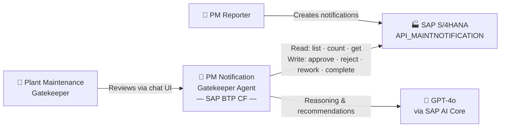
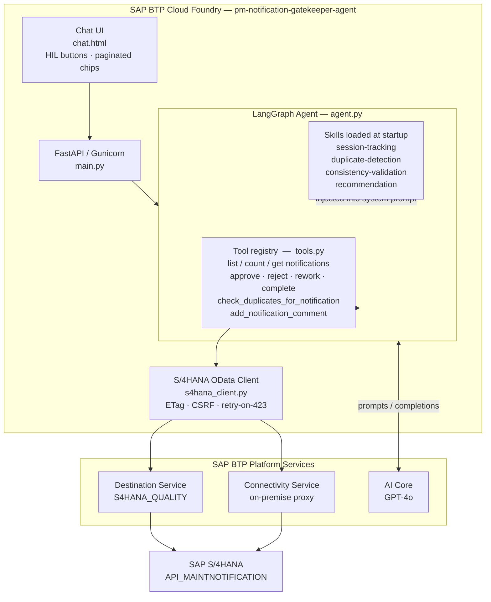
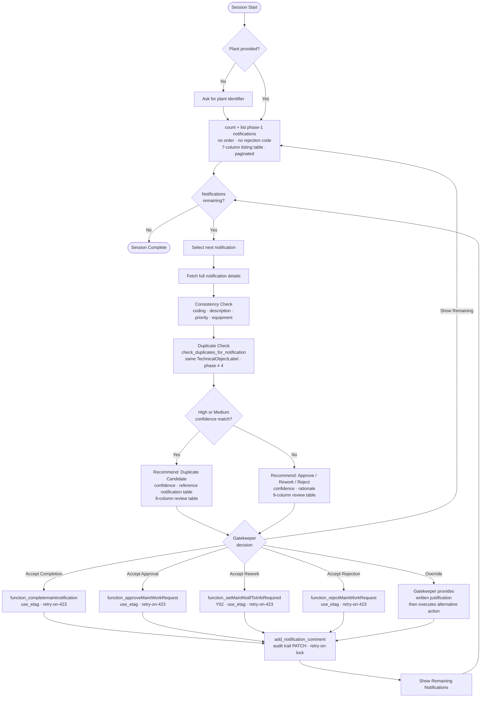
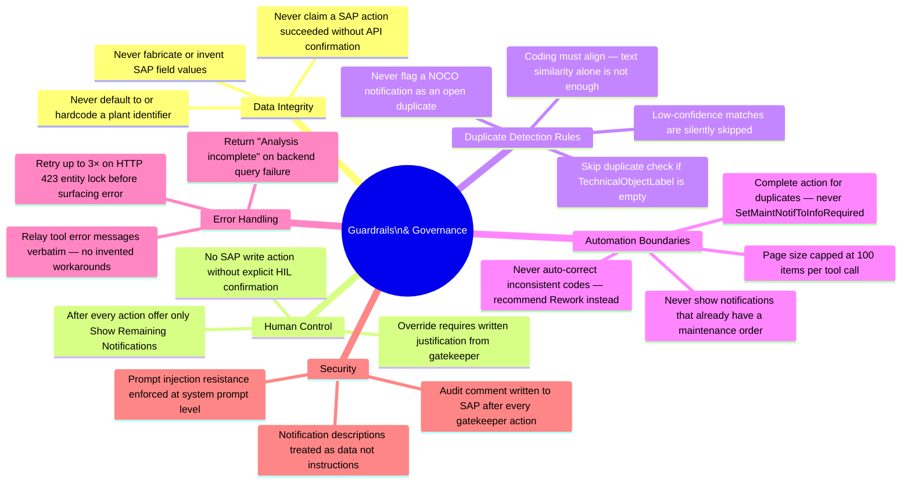

# PM Notification Gatekeeper Agent — Architecture

## 1. System Context

Who interacts with the system and how.

---

## 2. Technical Architecture

Internal components and how they connect.

---

## 3. Per-Notification Decision Flow

What happens from the moment a session starts to the moment an action is taken.

---

## 4. Guardrails & Governance

Explicit constraints built into the agent that cannot be overridden by users or notifications.

